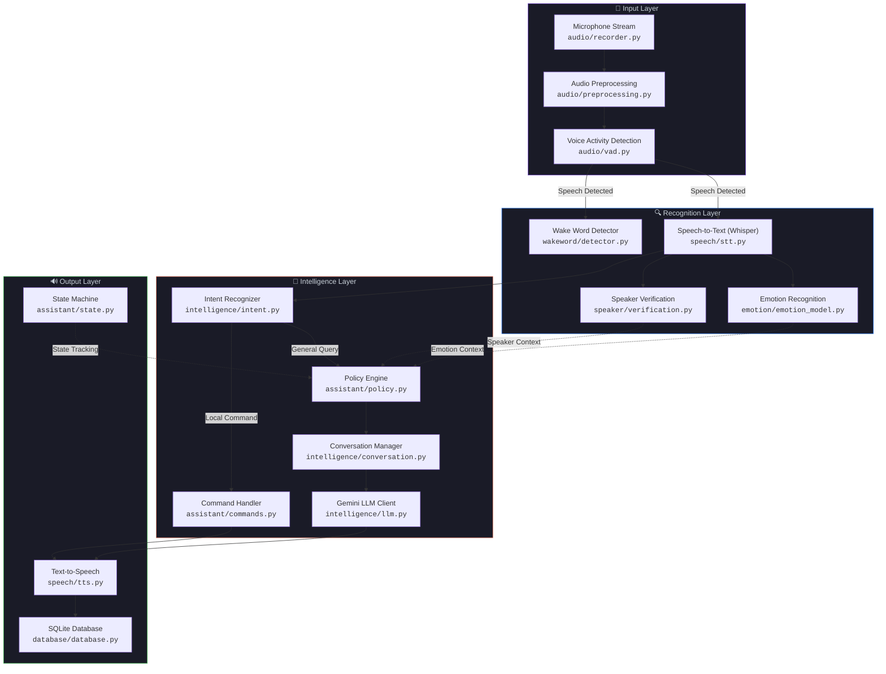
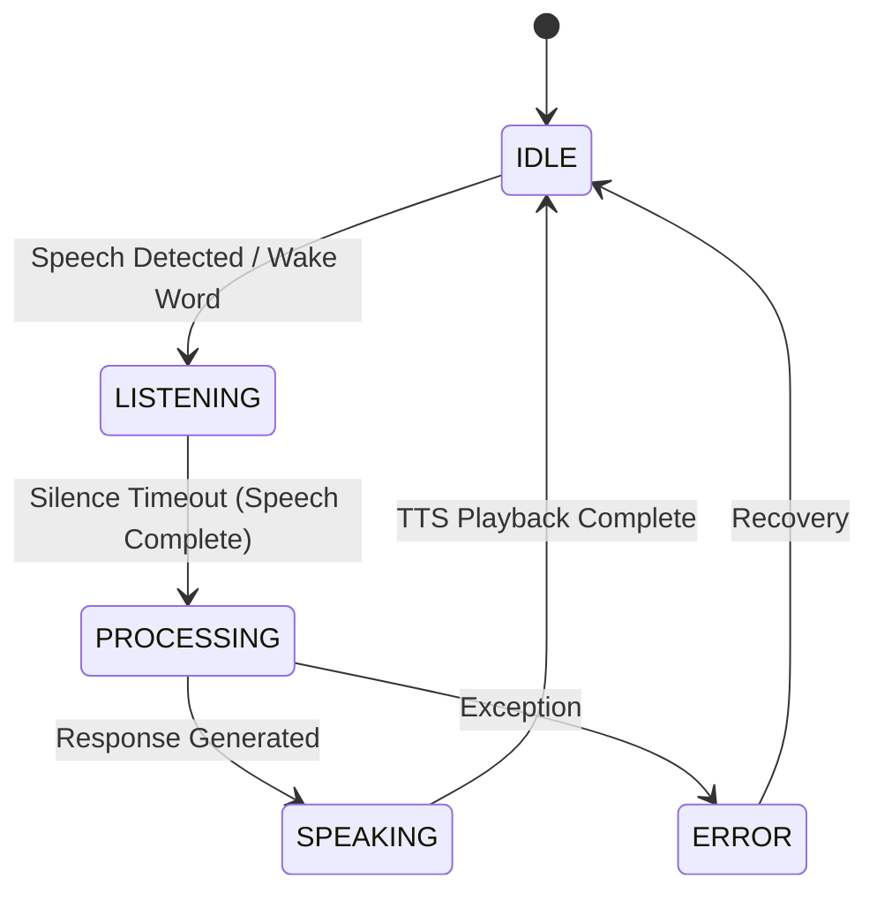
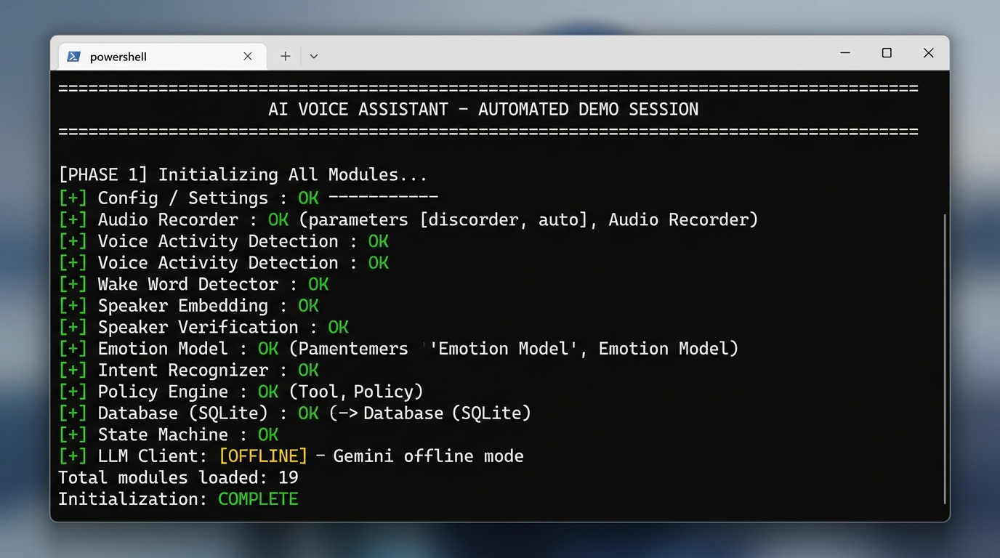
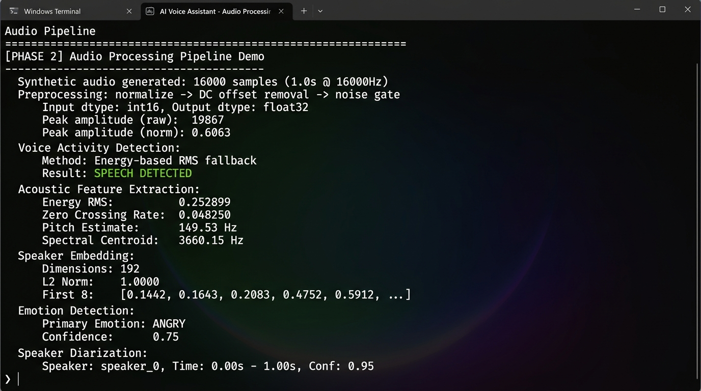
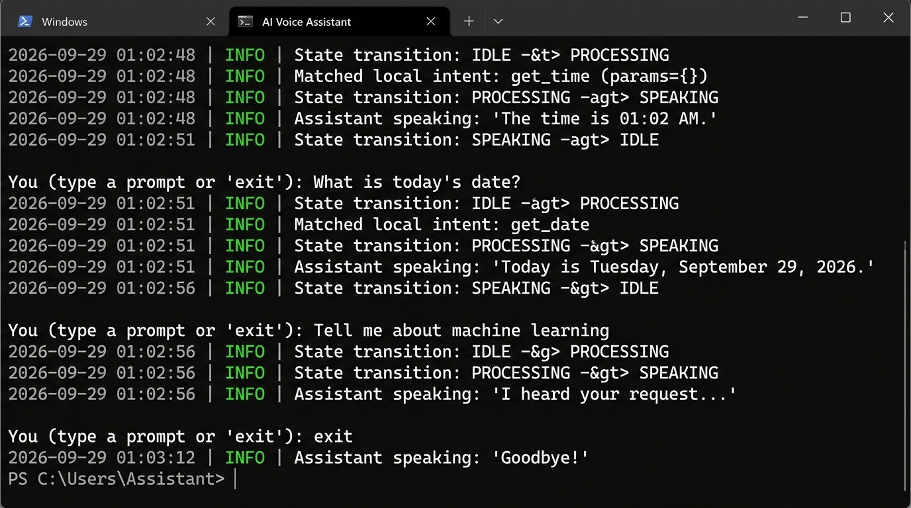
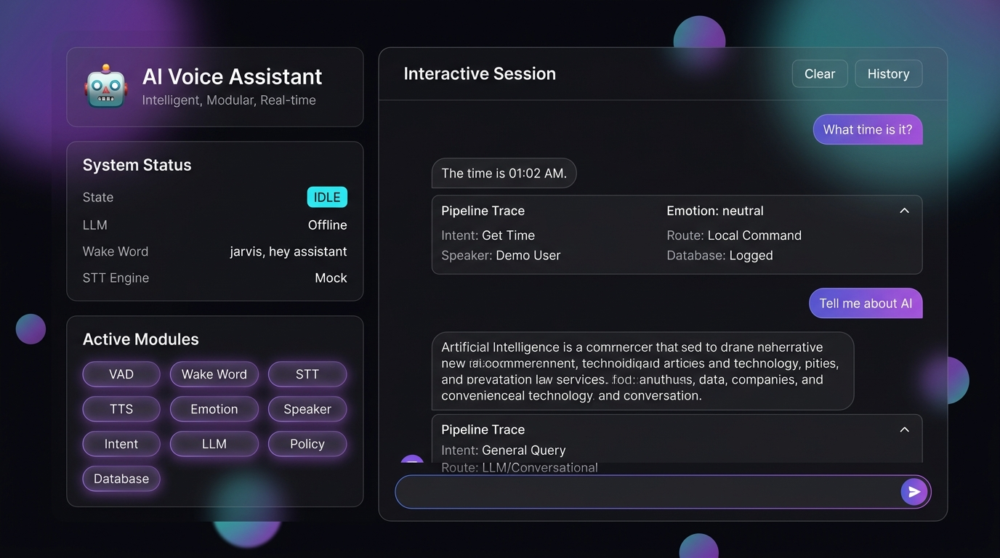
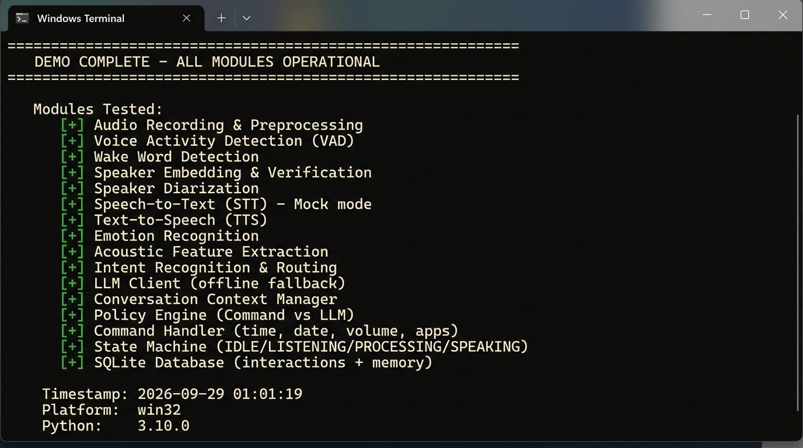

<div align="center">

<!-- Animated Header -->


<br/>

<!-- Typing Animation -->
<a href="#">
  
</a>

<br/>

<!-- Badges -->


<br/>


<br/>

**Explainable AI Interactive Voice Assistant for Remote Sensing & Physics (PoC Prototype)**
Featuring two-way voice interaction, speaker biometrics with topic memory, physics invariant verification against adversarial sources, governing equations & citations, and real-time neural attention graphing.

[🚀 Launch Web Prototype](#-launching-the-remote-sensing-xai-prototype) · [✨ PRD Feature Compliance](#-prd-feature-compliance) · [🏗️ Architecture](#%EF%B8%8F-system-architecture) · [🛠️ Configuration](#%EF%B8%8F-configuration)

</div>

---

## 🛰️ Launching the Remote Sensing XAI Prototype

Run the local web prototype with:
```bash
python web_demo.py
```
Open **[http://127.0.0.1:5000](http://127.0.0.1:5000)** in your browser.

### 🌟 Implemented PRD Features & UI Design:
1. **Preferred UI Design**:
   - **Screen 1 (Home Dashboard)**: Warm ember / burnt orange gradient, dynamic island, Roobinium profile header with notifications and drawer menu, bold headline *"What are we building today?"*, quick suggestion cards with star icons (✦), and bottom glassmorphic input card with model pill and glowing microphone button.
   - **Screen 2 (Active Voice Mode)**: "✕ Close chat" button, 3D luminous glowing golden/amber orb with audio-reactive pulsing, *"Aira is listening...."* status indicator, large clean transcription text, and bottom voice controls.
   - **Explainability & Neural Links Drawer (XAI Panel)**: Pull-up drawer displaying governing physics equations, ground citations, confidence gauge, and interactive neural attention graph.
2. **FR-1 (Two-Way Voice Interaction)**: Browser microphone speech capture, Web Speech API audio synthesis, and real-time query transcription.
3. **FR-2 (Voice Recognition & Session Memory)**: Biometric speaker identification, cosine similarity score matching against enrolled analyst `Roobinium`, and automatic session topic resumption (*"SAR Phase Shift & Interferometry"*).
4. **FR-3 (Explainability & Grounding)**: Precise mathematical equations ($\text{NDVI} = \frac{\text{NIR} - \text{RED}}{\text{NIR} + \text{RED}}$, $\Delta\phi = \frac{4\pi}{\lambda}\Delta R$, $I_{\text{scat}} \propto \lambda^{-4}$, $\sigma^0$), grounding confidence score, and NASA/IEEE citations.
5. **FR-4 (Neural Path & Weight Visualization)**: Interactive Canvas/SVG force-directed neural graph depicting active token connections and attention weight distribution.
6. **FR-5 (Adversarial / Corrupted Source Detection)**: Physics Invariant Validator actively detects contradictions with physical laws (e.g., testing *"Does radar require sunlight?"* triggers a contradiction flag, physics explanation, and confidence penalty).

---

## 📋 Table of Contents

- [About the Project](#-about-the-project)
- [Features](#-features)
- [Tech Stack](#-tech-stack)
- [System Architecture](#%EF%B8%8F-system-architecture)
- [Project Structure](#-project-structure)
- [Quick Start](#-quick-start)
- [Usage](#-usage)
- [Screenshots](#-screenshots)
- [Configuration](#%EF%B8%8F-configuration)
- [API Reference](#-api-reference)
- [Roadmap](#-roadmap)
- [Contributing](#-contributing)
- [License](#-license)
- [Acknowledgements](#-acknowledgements)

---

## 🎯 About the Project

**AI Voice Assistant** is a fully modular, event-driven voice assistant framework designed to showcase a complete speech processing pipeline — from raw microphone input to intelligent response generation and spoken output.

Unlike monolithic voice assistants, every component is **independently swappable**, **gracefully degradable**, and **testable in isolation**. If a dependency isn't installed, the system automatically falls back to the next best option or enters mock mode — ensuring the assistant always runs.

### 💡 Why This Project?

| Problem | Solution |
|---|---|
| Voice assistants are black boxes | Every module is transparent, documented, and modular |
| Hard to test without hardware | CLI mode + Web Demo UI for full testing without a microphone |
| Tightly coupled to one LLM vendor | Supports `google-genai`, `google-generativeai`, and offline fallback |
| No emotion awareness | Real-time acoustic emotion classification (happy, sad, angry, neutral, surprised) |
| Single-user only | Speaker verification with voice biometric enrollment |

---

## ✨ Features

<table>
<tr>
<td width="50%">

### 🎤 Audio & Voice Pipeline
- **Real-Time Microphone Capture** — Low-latency 16kHz PCM streaming via `sounddevice`
- **Voice Activity Detection (VAD)** — WebRTC VAD + energy-based detection to filter silence
- **Audio Preprocessing** — DC offset removal, normalization, and noise gating
- **Wake Word Detection** — Configurable keyword spotting (e.g., *"Jarvis"*, *"Hey Assistant"*)

</td>
<td width="50%">

### 🧠 Intelligence & AI
- **Google Gemini LLM** — Conversational AI powered by `gemini-3.8-flash` (configurable)
- **Local Intent Recognition** — Regex-based command routing for instant actions (time, date, volume, app launch)
- **Context-Aware Conversations** — Multi-turn dialog with sliding window history
- **Policy Engine** — Smart routing: local commands → instant execution; general queries → LLM

</td>
</tr>
<tr>
<td width="50%">

### 🔊 Speech Processing
- **Speech-to-Text (STT)** — `faster-whisper` (CTranslate2) with `openai-whisper` fallback
- **Text-to-Speech (TTS)** — `pyttsx3` offline synthesis with configurable voice & rate
- **Multi-Engine Fallback** — Automatic engine selection based on installed packages

</td>
<td width="50%">

### 👤 Speaker & Emotion
- **Speaker Verification** — Voice biometric embeddings with cosine similarity matching
- **Speaker Diarization** — Multi-speaker segmentation support
- **Emotion Recognition** — Acoustic feature extraction (pitch, RMS, ZCR, spectral centroid) for affective state classification
- **Enrolled Speaker Database** — Persistent voiceprint storage

</td>
</tr>
<tr>
<td width="50%">

### 💾 Data & Persistence
- **SQLite Database** — Logs all interactions (speaker, query, response, emotion)
- **Conversation Memory** — Persistent multi-turn context across sessions
- **Speaker Profile Storage** — Enrolled voice biometric profiles

</td>
<td width="50%">

### 🌐 Interfaces & Modes
- **Voice Loop Mode** — Real-time microphone → response pipeline
- **Interactive CLI Mode** — Text-based testing without hardware
- **Web Demo (Flask)** — Beautiful browser-based UI showcasing all modules
- **Finite State Machine** — Clean `IDLE → LISTENING → PROCESSING → SPEAKING` lifecycle

</td>
</tr>
</table>

---

## 🛠️ Tech Stack

<div align="center">

| Layer | Technology | Purpose |
|:---:|:---:|:---|
|  | **Python 3.10+** | Core language |
|  | **PyTorch** | Deep learning backend for embeddings & models |
|  | **Google Gemini** | Generative AI for conversational intelligence |
|  | **Flask** | Web demo server |
|  | **SQLite** | Lightweight persistent storage |
| 🎙️ | **Faster-Whisper** | CTranslate2-optimized speech-to-text |
| 🔊 | **pyttsx3** | Offline text-to-speech synthesis |
| 🎧 | **SoundDevice** | Real-time audio I/O |
| 🗣️ | **WebRTC VAD** | Voice activity detection |
| 📐 | **NumPy / SciPy** | Signal processing & feature extraction |

</div>

---

## 🏗️ System Architecture



### 🔄 State Machine Lifecycle



---

## 📁 Project Structure

```
AI-Voice-Assistant/
│
├── 🎧 audio/                        # Audio I/O & Signal Processing
│   ├── recorder.py                  #   └─ Microphone stream capture (16kHz, mono)
│   ├── preprocessing.py             #   └─ Normalization, DC offset, noise gate
│   └── vad.py                       #   └─ WebRTC + energy-based voice detection
│
├── 🗣️ wakeword/                     # Wake Word Detection
│   └── detector.py                  #   └─ Keyword spotting ("Jarvis", "Hey Assistant")
│
├── 👤 speaker/                      # Speaker Biometrics
│   ├── verification.py              #   └─ Cosine similarity speaker matching
│   ├── embedding.py                 #   └─ Voice biometric embedding extraction
│   ├── diarization.py               #   └─ Multi-speaker segmentation
│   └── database.py                  #   └─ Enrolled speaker voiceprint storage
│
├── 🎤 speech/                       # Speech ↔ Text
│   ├── stt.py                       #   └─ Whisper/Faster-Whisper transcription
│   └── tts.py                       #   └─ pyttsx3 offline speech synthesis
│
├── 😊 emotion/                      # Affective Computing
│   ├── emotion_model.py             #   └─ Multimodal emotion classification
│   └── features.py                  #   └─ Pitch, RMS, ZCR, spectral features
│
├── 🧠 intelligence/                 # AI & NLP
│   ├── llm.py                       #   └─ Google Gemini generative client
│   ├── intent.py                    #   └─ Local command intent recognition
│   └── conversation.py              #   └─ Multi-turn dialog context manager
│
├── 🤖 assistant/                    # Core Orchestration
│   ├── state.py                     #   └─ Finite state machine (IDLE→SPEAKING)
│   ├── policy.py                    #   └─ Decision routing (Command vs LLM)
│   └── commands.py                  #   └─ System command handlers (time, volume, apps)
│
├── 💾 database/                     # Persistence
│   └── database.py                  #   └─ SQLite interaction logging & memory
│
├── ⚙️ config/                       # Configuration
│   └── settings.py                  #   └─ Centralized dataclass config (.env)
│
├── 🔧 utils/                        # Utilities
│   └── logger.py                    #   └─ Colored console logging
│
├── 📸 screenshots/                  # Demo Screenshots
│
├── main.py                          # 🚀 Master CLI application entrypoint
├── web_demo.py                      # 🌐 Flask web demo interface
├── demo_run.py                      # 🧪 Automated demo script
├── test_main.py                     # ✅ Test suite
├── requirements.txt                 # 📦 Python dependencies
├── .env                             # 🔑 Environment variables & API keys
└── .gitignore                       # 🚫 Git ignore rules
```

---

## 🚀 Quick Start

### Prerequisites

- **Python 3.10+** installed
- A **Google Gemini API Key** ([Get one free here](https://aistudio.google.com/apikey))
- *Optional:* Microphone hardware (for voice mode)

### 1️⃣ Clone & Setup Virtual Environment

```bash
git clone https://github.com/yourusername/AI-Voice-Assistant.git
cd AI-Voice-Assistant

# Create virtual environment
python -m venv venv

# Activate it
# Windows:
venv\Scripts\activate
# Linux/macOS:
source venv/bin/activate
```

### 2️⃣ Install Dependencies

```bash
pip install -r requirements.txt
```

<details>
<summary>📦 <b>Full Dependency List</b> (click to expand)</summary>
<br/>

| Package | Version | Purpose |
|---|---|---|
| `numpy` | ≥1.24.0 | Array operations & signal processing |
| `scipy` | ≥1.10.0 | Scientific computing & audio filters |
| `sounddevice` | ≥0.4.6 | Real-time microphone I/O |
| `webrtcvad-wheels` | ≥2.0.10 | Voice activity detection |
| `faster-whisper` | ≥1.0.0 | CTranslate2 speech-to-text |
| `pyttsx3` | ≥2.90 | Offline text-to-speech |
| `torch` | ≥2.0.0 | Deep learning framework |
| `torchaudio` | ≥2.0.0 | Audio processing with PyTorch |
| `google-genai` | ≥0.1.1 | Google Gemini SDK |
| `python-dotenv` | ≥1.0.0 | Environment variable loader |
| `pydantic-settings` | ≥2.0.0 | Settings validation |
| `flask` | ≥3.0.0 | Web demo server |
| `requests` | ≥2.31.0 | HTTP utilities |

</details>

### 3️⃣ Configure Environment

```bash
# Copy and edit the .env file
cp .env.example .env    # or just edit .env directly
```

Set your **Gemini API Key** in `.env`:

```ini
GEMINI_API_KEY=your_actual_api_key_here
```

### 4️⃣ Run the Assistant

```bash
# 🎯 Interactive CLI mode (no microphone needed):
python main.py --cli

# 🎤 Real-time voice mode (requires microphone):
python main.py

# 🌐 Web demo (browser-based UI):
python web_demo.py
# Then open → http://localhost:5000
```

---

## 📖 Usage

### Interactive CLI Mode

Perfect for testing without a microphone. Type queries and get AI responses:

```
$ python main.py --cli

[INFO] Initializing AI Voice Assistant components...
[INFO] Loaded faster-whisper model 'base' on cpu.
[INFO] AI Voice Assistant in Interactive Mode...
🔊 "Hello! I am ready to assist you."

You (type a prompt or 'exit'): What time is it?
🔊 "The time is 12:25 PM."

You (type a prompt or 'exit'): Tell me about black holes
🔊 "Black holes are regions of spacetime where gravity is so strong..."

You (type a prompt or 'exit'): open notepad
🔊 "Opening notepad."

You (type a prompt or 'exit'): exit
🔊 "Goodbye!"
```

### Voice Loop Mode

Full hands-free operation with wake word activation:

```
$ python main.py

[INFO] Starting real-time voice listening loop...
🎧 Listening for wake word "Jarvis"...
🎤 Speech detected → Transcribing...
👤 Speaker: Admin (similarity: 0.92)
😊 Emotion: happy (confidence: 0.78)
🧠 Processing: "What's the weather like?"
🔊 Speaking response...
```

### Web Demo

A beautiful browser-based interface that showcases every module:

```bash
python web_demo.py
# Open http://localhost:5000
```

---

## 📸 Screenshots

<div align="center">

| Module Initialization | Audio Pipeline |
|:---:|:---:|
|  |  |

| Interactive Session | Web Demo UI |
|:---:|:---:|
|  |  |

| Demo Summary |
|:---:|
|  |

</div>

---

## ⚙️ Configuration

All settings are managed through the `.env` file and loaded via the centralized `config/settings.py` dataclass system.

<details>
<summary>🔑 <b>Complete .env Reference</b> (click to expand)</summary>
<br/>

```ini
# ─────────────── API Keys ───────────────
GEMINI_API_KEY=your_gemini_api_key_here

# ─────────────── Wake Word ───────────────
WAKEWORD_ENABLED=True              # Enable/disable wake word gate
WAKE_WORDS=jarvis,hey assistant    # Comma-separated trigger phrases
WAKEWORD_SENSITIVITY=0.5           # Detection sensitivity (0.0 → 1.0)

# ─────────────── Audio ───────────────
AUDIO_SAMPLE_RATE=16000            # Sample rate in Hz
AUDIO_CHANNELS=1                   # Mono audio
AUDIO_CHUNK_SIZE=1024              # Samples per chunk
VAD_AGGRESSIVENESS=3               # WebRTC VAD level (0=lenient, 3=aggressive)
SILENCE_TIMEOUT_SEC=1.5            # Seconds of silence to end utterance

# ─────────────── Speech (STT & TTS) ───────────────
STT_MODEL_SIZE=base                # Whisper model: tiny, base, small, medium, large
STT_DEVICE=cpu                     # cpu or cuda
TTS_ENGINE=pyttsx3                 # auto, pyttsx3, sapi, or print
TTS_RATE=180                       # Speech rate (words per minute)

# ─────────────── Intelligence & LLM ───────────────
LLM_MODEL=gemini-3.8-flash        # Gemini model variant
LLM_TEMPERATURE=0.7               # Creativity (0.0=deterministic, 1.0=creative)
MAX_HISTORY_TURNS=10               # Conversation context window size

# ─────────────── Speaker & Emotion ───────────────
SPEAKER_VERIFICATION_THRESHOLD=0.75   # Cosine similarity threshold
SPEAKER_EMBEDDING_DIM=192            # Embedding vector dimension
EMOTION_DETECTION_ENABLED=True        # Enable emotion classification

# ─────────────── Database & Logging ───────────────
DATABASE_PATH=data/assistant.db    # SQLite database location
LOG_LEVEL=INFO                     # DEBUG, INFO, WARNING, ERROR
```

</details>

---

## 📚 API Reference

### Core Classes

| Class | Module | Description |
|---|---|---|
| `VoiceAssistant` | `main.py` | Master orchestrator — initializes all components and runs the main loop |
| `AudioRecorder` | `audio/recorder.py` | Captures real-time PCM audio from the system microphone |
| `VoiceActivityDetector` | `audio/vad.py` | WebRTC + energy-based speech/silence classification |
| `WakeWordDetector` | `wakeword/detector.py` | Configurable keyword spotting on transcriptions |
| `SpeechToText` | `speech/stt.py` | Whisper-based audio → text transcription |
| `TextToSpeech` | `speech/tts.py` | Text → spoken audio via pyttsx3 |
| `SpeakerVerification` | `speaker/verification.py` | Voice biometric matching against enrolled profiles |
| `EmotionModel` | `emotion/emotion_model.py` | Acoustic + textual emotion classification |
| `IntentRecognizer` | `intelligence/intent.py` | Regex-based local command detection |
| `LLMClient` | `intelligence/llm.py` | Google Gemini API client with multi-SDK support |
| `ConversationManager` | `intelligence/conversation.py` | Multi-turn dialog history management |
| `PolicyEngine` | `assistant/policy.py` | Decision router: local command vs. LLM query |
| `CommandHandler` | `assistant/commands.py` | System action executor (time, date, volume, apps) |
| `StateManager` | `assistant/state.py` | Finite state machine lifecycle manager |
| `DatabaseManager` | `database/database.py` | SQLite persistence for interactions & memory |

### Built-in Voice Commands

| Command | Example Phrases | Action |
|---|---|---|
| 🕐 **Get Time** | *"What time is it?"*, *"Tell me the time"* | Returns current system time |
| 📅 **Get Date** | *"What's the date?"*, *"What day is today?"* | Returns current date |
| 🔊 **Set Volume** | *"Volume to 80"*, *"Set volume at 50"* | Adjusts system master volume |
| 📂 **Open App** | *"Open notepad"*, *"Launch calculator"* | Launches system applications |
| 🛑 **Stop** | *"Goodbye"*, *"Exit"*, *"Shutdown"* | Gracefully exits the assistant |

---

## 🗺️ Roadmap

- [x] Modular audio capture & preprocessing pipeline
- [x] WebRTC voice activity detection
- [x] Wake word detection
- [x] Faster-Whisper speech-to-text
- [x] Google Gemini LLM integration
- [x] Local intent recognition & command execution
- [x] Speaker verification with biometric embeddings
- [x] Emotion recognition from acoustic features
- [x] SQLite persistent memory
- [x] Interactive CLI mode
- [x] Flask web demo
- [ ] GPU acceleration for STT/embeddings (CUDA)
- [ ] Streaming TTS with real-time audio playback
- [ ] Plugin system for custom skills/commands
- [ ] Multi-language support
- [ ] REST API for external integrations
- [ ] Docker containerization
- [ ] Voice cloning / custom TTS voices
- [ ] Continuous wake word (always-on hotword) with Porcupine

---

## 🤝 Contributing

Contributions are welcome! Here's how to get started:

1. **Fork** the repository
2. **Create** your feature branch (`git checkout -b feature/amazing-feature`)
3. **Commit** your changes (`git commit -m 'Add amazing feature'`)
4. **Push** to the branch (`git push origin feature/amazing-feature`)
5. **Open** a Pull Request

### Development Guidelines

- Follow **PEP 8** coding standards
- Add **docstrings** to all public classes and methods
- Keep modules **loosely coupled** — use dependency injection
- Ensure **graceful fallbacks** when optional packages are missing
- Write **tests** for new features

---

## 📄 License

Distributed under the **MIT License**. See `LICENSE` for more information.

---

## 🙏 Acknowledgements

<div align="center">

| | Project | |
|:---:|---|:---:|
|  | [Google Gemini](https://ai.google.dev/) — Generative AI | ⭐ |
| 🎙️ | [Faster-Whisper](https://github.com/SYSTRAN/faster-whisper) — CTranslate2 STT | ⭐ |
| 🤖 | [OpenAI Whisper](https://github.com/openai/whisper) — Speech Recognition | ⭐ |
|  | [PyTorch](https://pytorch.org/) — Deep Learning Framework | ⭐ |
| 🔊 | [pyttsx3](https://github.com/nateshmbhat/pyttsx3) — Offline TTS | ⭐ |
| 🎧 | [SoundDevice](https://python-sounddevice.readthedocs.io/) — Audio I/O | ⭐ |

</div>

---

<div align="center">


<br/>

**Built with ❤️ and Python**

<a href="#top">⬆️ Back to Top</a>

</div>
